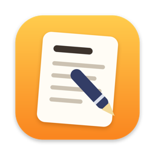

<p align="center">
  
</p>

<h1 align="center">Infinity Notes</h1>

<p align="center">
  A free, open-source notes app for macOS, built natively with SwiftUI.
  <br>
  <a href="https://github.com/1labs-ai/infinity-notes/actions/workflows/ci.yml"></a>
  <a href="LICENSE"></a>
  
  <a href="CONTRIBUTING.md"></a>
</p>

Infinity Notes brings the core Apple Notes experience to an app anyone can read,
change, and extend: nested folders, a date-grouped notes list with pinning, a
rich-text editor, search, and Recently Deleted with 30-day retention. Your notes
stay on your Mac.

The app is an original implementation. Its feature map came from static analysis
of the Notes app bundle with [REA](https://github.com/morluto/rea) — see
[docs/notes-feature-map.md](docs/notes-feature-map.md), where each item is marked
observed, inferred, or unknown. No Apple code or assets are included.

## Features

- **Folders and subfolders** up to 4 levels, with drag-and-drop to move notes and folders
- **Notes list** grouped into Pinned, Today, Yesterday, Previous 7 Days, Previous 30 Days, and by month and year
- **Rich-text editor** with Title, Heading, Subheading, Body, and Monostyled styles; bulleted, dashed, and numbered lists; bold, italic, underline, and strikethrough
- **Apple Notes keyboard shortcuts**, such as ⇧⌘T for Title and ⇧⌘7 for a bulleted list
- **Search** across every note
- **Recently Deleted** with recovery and automatic removal after 30 days

## Requirements

- macOS 15+, Xcode 16+
- [XcodeGen](https://github.com/yonaskolb/XcodeGen) (`brew install xcodegen`)

## Build and run

The Xcode project is generated from `project.yml` and is not committed.

```bash
xcodegen generate
open InfinityNotes.xcodeproj        # then Run (⌘R)
```

From the command line:

```bash
xcodebuild -project InfinityNotes.xcodeproj -scheme InfinityNotes -derivedDataPath build test
open "build/Build/Products/Debug/Infinity Notes.app"
```

## Layout

| Path | Contents |
|---|---|
| `Sources/Models.swift` | SwiftData `Folder` (with subfolders) and `Note` models |
| `Sources/FolderTree.swift` | Folder nesting rules (depth cap, no cycles) and the drag-and-drop payload |
| `Sources/NoteText.swift` | Title/preview derivation, RTF storage, list markers, retention |
| `Sources/DateGrouping.swift` | Today / Yesterday / Previous 7 / 30 Days / month / year sections |
| `Sources/TextFormatting.swift` | Paragraph styles, bold/italic/underline/strikethrough, lists |
| `Sources/RichTextView.swift` | `NSTextView` editor bridge |
| `Sources/TitleSuggester.swift` | Title suggestions: on-device Apple Intelligence model, keyword fallback |
| `Sources/CompareNotesView.swift` | Side-by-side note comparison with line-difference highlighting |
| `Sources/ContentView.swift`, `SidebarView.swift`, `NoteListView.swift` | Three-column UI |
| `Sources/InfinityNotesApp.swift` | App entry, menu commands and shortcuts |
| `Tests/` | Unit tests for the pure logic |
| `scripts/make-icon.sh` | Regenerates the app icon from `scripts/make-icon.swift` |

## Folders

- Right-click a folder > **New Subfolder** to make a subfolder (up to 4 levels).
- Move a note with drag-and-drop onto a folder, or right-click > **Move to**. Moving a note out of
  Recently Deleted recovers it.
- Move a folder by dragging it onto another folder, or onto **On My Mac** to make it top-level.
- Deleting a folder sends its notes, and its subfolders' notes, to Recently Deleted.

## Roadmap

Not built yet, and open for contributors: gallery view, sort options, checklists,
tables, image attachments, tags, Markdown export, and sync. See the
[open issues](https://github.com/1labs-ai/infinity-notes/issues) to pick one up.

## Contributing

Contributions of every size are welcome. Read [CONTRIBUTING.md](CONTRIBUTING.md) to get
set up, then look for issues labeled
[`good first issue`](https://github.com/1labs-ai/infinity-notes/labels/good%20first%20issue).
Please follow our [Code of Conduct](CODE_OF_CONDUCT.md), and report security issues
as described in [SECURITY.md](SECURITY.md).

## License

[MIT](LICENSE) © One Infinity Labs, Inc. and contributors.

Infinity Notes is an independent project and is not affiliated with, endorsed by, or
sponsored by Apple Inc. Apple and Apple Notes are trademarks of Apple Inc.
